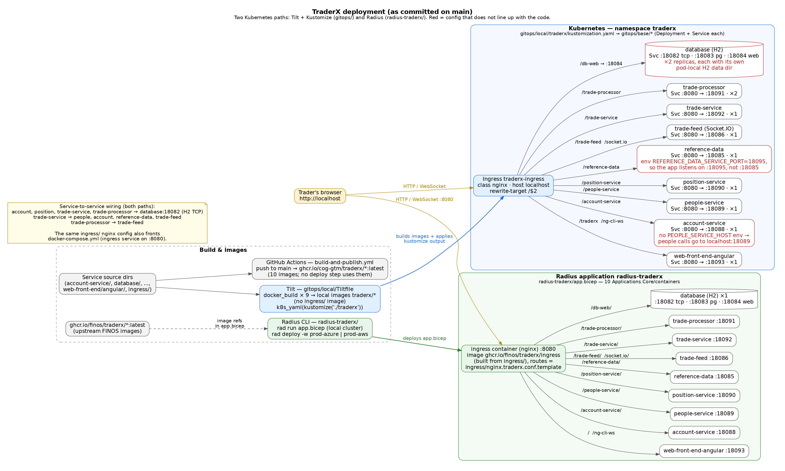

# Deployment

This diagram shows how TraderX deploys from what is committed in this repository. There are two Kubernetes paths:

- **Tilt + Kustomize** ([`gitops/`](https://github.com/COG-GTM/traderXCognitiondemos/tree/main/gitops)). `gitops/local/Tiltfile` builds nine images locally (`traderx/*`) and applies `kustomize gitops/local/traderx`. That puts a Deployment and Service per component in the `traderx` namespace, and an `Ingress` (class `nginx`, host `localhost`, `rewrite-target /$2`) routes path prefixes to each Service on port 8080. You need an nginx ingress controller in the cluster (see the [README](https://github.com/COG-GTM/traderXCognitiondemos#usage-k8s)).
- **Radius** ([`radius-traderx/app.bicep`](https://github.com/COG-GTM/traderXCognitiondemos/blob/main/radius-traderx/app.bicep)). Ten `Applications.Core/containers` that pull the upstream `ghcr.io/finos/traderx/*:latest` images. Here the [`ingress/`](https://github.com/COG-GTM/traderXCognitiondemos/tree/main/ingress) nginx container (`nginx.traderx.conf.template`) is the entry point on :8080. `rad run` deploys to a local cluster, and `rad deploy -w prod-azure | prod-aws` deploys to a cloud environment.

The same `ingress/` nginx container also fronts `docker-compose.yml`. The `build-and-publish.yml` workflow pushes all ten images to `ghcr.io/cog-gtm/traderx/*:latest` on every push to `main`, but no deployment path in this repository pulls them.



Items in red don't match the application code:

- `gitops/base/reference-data` sets `REFERENCE_DATA_SERVICE_PORT=18095`, so the app listens on 18095, but the container port and Service `targetPort` are 18085.
- `gitops/base/account-service` doesn't set `PEOPLE_SERVICE_HOST`, so `people.service.url` falls back to `localhost:18089`.
- `gitops/base/database` runs 2 replicas, and each pod keeps its own H2 data directory behind the one `database` Service.

## Editing the diagram

The editable source is [`deployment/deployment-diagram.dot`](./deployment/deployment-diagram.dot) (Graphviz). After you edit it, re-render the PNG and SVG with:

```bash
sudo apt-get install -y graphviz   # once
docs/deployment/render.sh
```
