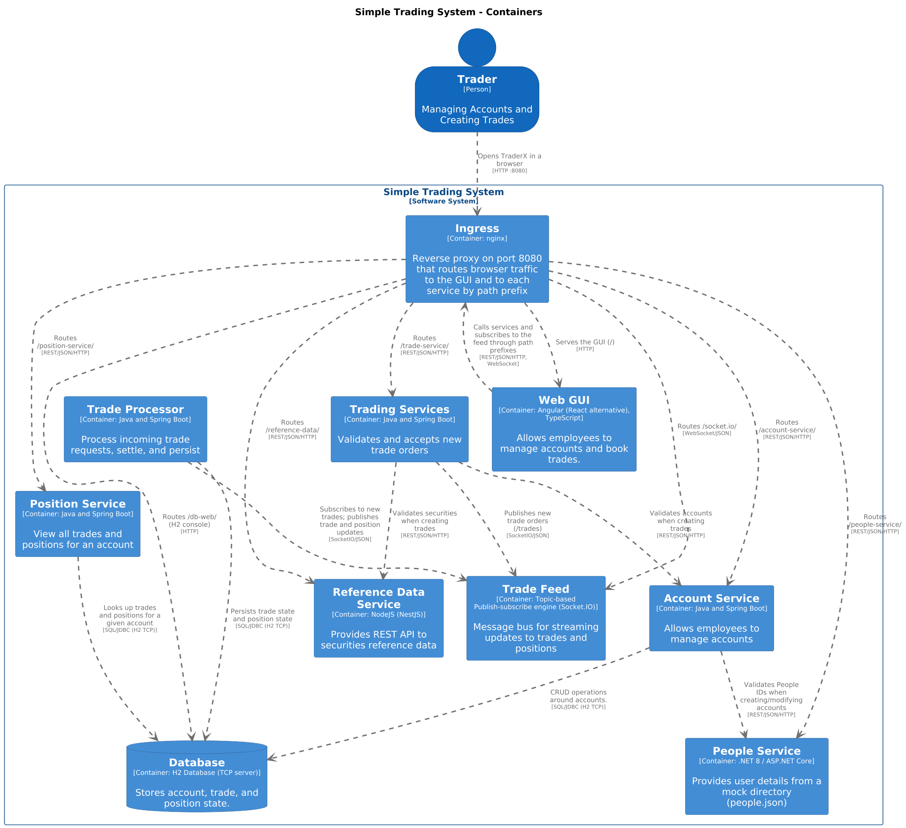

Below is a C4 diagram explaining the various componentry of the Sample Application.  The DSL for this diagram, as rendered, is [included](./c4/c4-diagram.dsl) in this repository. The image is the DSL's `full-system` view, exported with the [Structurizr CLI](https://github.com/structurizr/cli) and rendered with [PlantUML](https://plantuml.com) (needs Graphviz):

```sh
structurizr.sh export -w docs/c4/c4-diagram.dsl -f plantuml/structurizr -o /tmp/c4
java -jar plantuml.jar -tpng -Sdpi=150 /tmp/c4/structurizr-full-system.puml
cp /tmp/c4/structurizr-full-system.png docs/c4/c4-diagram.png
```

You can navigate to the [individual codebases from this page](./code.md).



See Also: [Sequence Diagrams and Flows](./flows.md)
