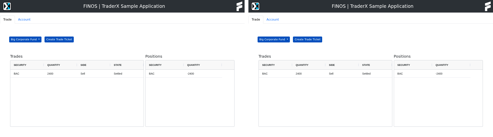
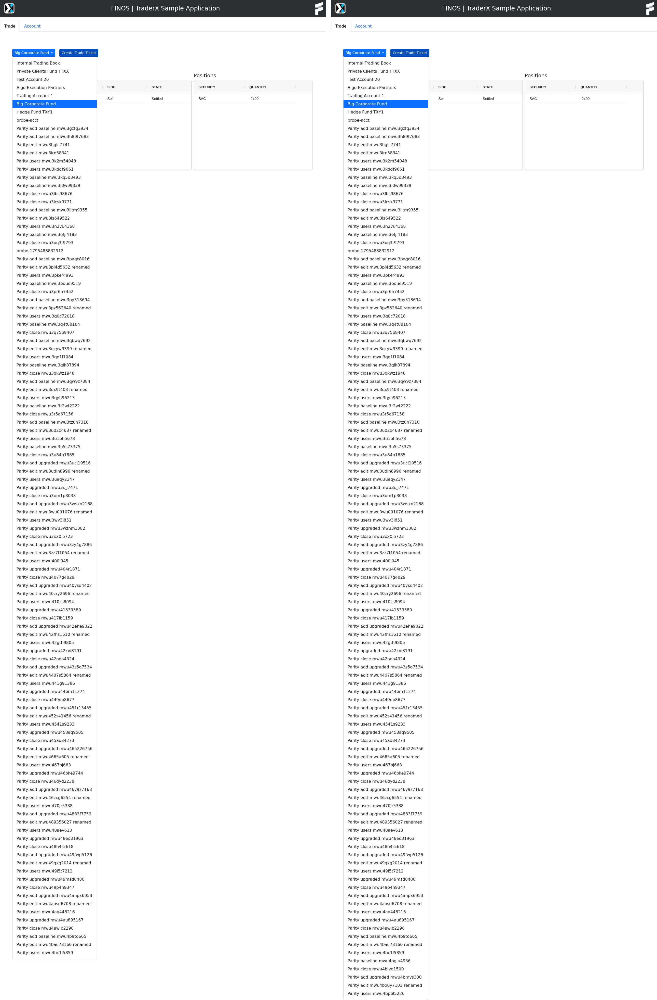
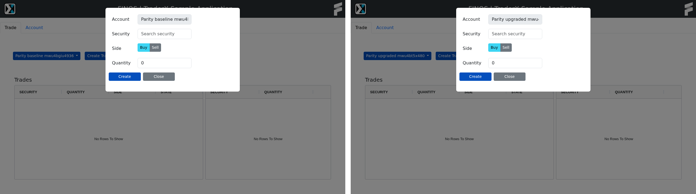
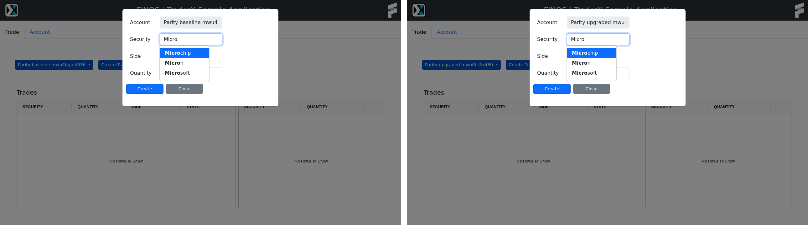
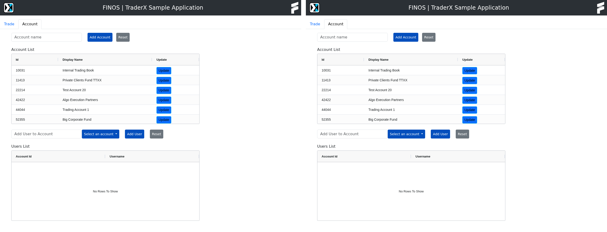
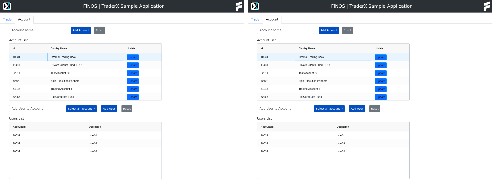
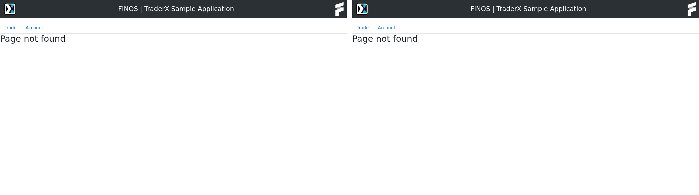

# Angular 18 -> 21 parity report

Same Playwright specs run against `baseline` (Angular 18, http://localhost:4000) and `upgraded` (Angular 21, http://localhost:4200), both against the same local TraderX backend.

## Spec results

| Spec | Baseline | Upgraded |
| --- | --- | --- |
| account.spec.ts > Account page > lists seeded accounts with an Update button per row | pass | pass |
| account.spec.ts > Account page > empty account name is rejected, a new account can be added | pass | pass |
| account.spec.ts > Account page > Update loads an account into the form and renames it; Reset clears it | pass | pass |
| account.spec.ts > Account page > selecting an account shows its users; a user can be assigned via typeahead | pass | pass |
| trade.spec.ts > Trade page > default route redirects to /trade and shows blotters for the default account | pass | pass |
| trade.spec.ts > Trade page > account dropdown lists accounts and switching reloads the blotters | pass | pass |
| trade.spec.ts > Trade page > trade ticket validates input, then books a trade that settles and updates positions | pass | pass |
| trade.spec.ts > Trade page > trade ticket Close button dismisses without booking | pass | pass |
| trade.spec.ts > unknown route shows Page not found | pass | pass |

## Screenshots (baseline left, upgraded right)

| Page / flow | Pixel diff | Side by side |
| --- | --- | --- |
| 01-trade | 0.00% |  |
| 02-trade-account-dropdown | 0.07% |  |
| 03-trade-ticket | 0.10% |  |
| 04-trade-ticket-typeahead | 0.10% |  |
| 05-account | 0.00% |  |
| 06-account-users | 0.00% |  |
| 07-not-found | 0.00% |  |

## Notes

- Both apps share one backend and every run creates timestamped accounts and trades, so non-zero pixel diffs come from data created between the baseline and upgraded runs (e.g. the account dropdown list is longer, the ticket shows that run's account name), not from rendering differences.
- `retries: 1` is set because AG Grid row virtualization and the 200 ms account-list debounce can race a fresh backend; the recorded run used `--retries=0`.
